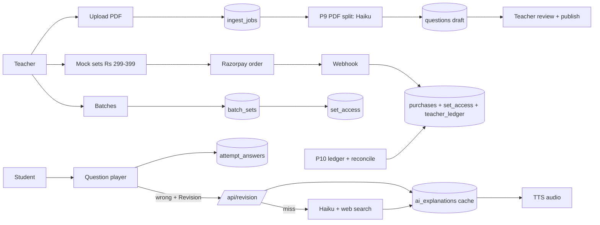

# PolityPedia design v1 (draft 1, 2026-11-04)

Status: v1 DRAFT 1. Built with the `system-design` skill. Not yet run by Reality Checker.
Base: v0 design (frozen copy: `versions/v0-2026-11-04/design/design.md`). Everything in v0 stays unless this file changes it.
Source of v1 decisions: Boss sketch `research/2026-11-04-v1-sketch.jpg` + walkthrough + rounds 2 and 3 in `notes.md` (2026-11-04).
UI and visual rules live in `ui-design-guide.md` (becomes `DESIGN.md` in the app repo). Windows treats `DESIGN.md` and `design.md` as one file, so both cannot sit in this folder.

What v1 adds to v0: teacher batches, per-teacher past papers with a question player, paid mock test sets priced by the teacher, practice + timed exam modes, AI revision (text + audio) on wrong answers, three paid products (mock sets, AI plan, Pro), per-teacher revenue share, Razorpay.

---

## 1. Blockers (cannot decide alone)

| # | Blocker | Default until Boss answers |
|---|---|---|
| X1 | How the teacher is paid out. | Monthly manual bank transfer from the `teacher_ledger` report. Razorpay Route (auto split, needs teacher KYC) in V2. |
| X2 | How long a bought mock set stays open. | Until the teacher's next exam date for that exam + 30 days. If no date set: 12 months. |
| X3 | Teacher share base: on gross price or on net (after GST + gateway fee)? | Net. First teacher: 50% of net on mock set sales. |
| X4 | GST and marketplace tax (e-commerce operator TCS) on teacher sales. | Unverified. CA must confirm before the first paid sale. Prices treated as GST-inclusive. |
| X5 | Paid AI voice provider for Hindi + English. | ElevenLabs candidate (Boss's key exists per output style; untested this session). Price per character unverified. |
| X6 | Does Pro (Rs 500) have the same 30 new AI explanations/day cap as the AI plan? | Yes, same cap. Saved explanations unlimited. |
| X7 | Which web search tool version Haiku 5.5 accepts. | Skill lists `web_search_20260209` for Opus/Sonnet only. Verify with one test call; fall back to `web_search_20250305`. |
| X8 | Adda247 contract check (from v0): paid product raises the risk. | Still open. Check before charging. |

## 2. Requirements

### Functional (v1 additions; v0 F1-F11 stay)
- V1 Two roles: teacher, student (+ admin). Teacher signup stays invite only + admin approval (v0).
- V2 Batches: teacher creates many batches. A student can be in many batches. Student joins by link or code. Teacher can remove a student.
- V3 Batch grants: teacher picks which of their mock sets a batch gets free. Teacher sees batch scores.
- V4 Student onboarding: pick exam(s), add (follow) teachers.
- V5 Teacher portfolio (student view): tiles Videos, Past papers, Mock tests, Notifications + **Follow** button (renamed from Subscribe; free; follower gets that teacher's notifications).
- V6 Videos: teacher pastes YouTube links. We fetch thumbnail + title. Teacher switch Show / No show. No show = "Coming soon".
- V7 Next exam date: each teacher keeps it per exam on their page.
- V8 Past papers: per teacher. Path Exam > Year > Month (optional) > PDF (questions, solutions or both). Teacher uploads and edits. Free for all students. PDF download stays.
- V9 PDF split: AI cuts the PDF into questions (stem, 4 options, answer, explanation if present). Teacher reviews, fixes, publishes. Nothing is live before teacher publish.
- V10 Question player (shared by past papers and mocks): exam name on top, 0 to N progress bar (question i of N), 4 options, Reveal answer (past papers), Mark for later.
- V11 Mock sets: teacher creates sets of tests, prices each set Rs 299 to Rs 399. First test of a set can be marked free sample.
- V12 Mock list: Test 1, 2, 3. Taken = tick + score. Attempt button. Choose full paper or one topic.
- V13 Modes: Practice (right/wrong after each question) and Exam (timed, result at the end, NTA-like).
- V14 Wrong answer screen: Wrong, right answer, teacher explanation (dropdown, if uploaded), Revision button.
- V15 Revision (AI): AI plan or Pro only. Context = exam + topic + question + options + right answer + teacher explanation + web search. Output in the sketch's format. Text + audio. One explanation per question (+ language), saved and reused by all students. Teacher can edit it. 30 NEW explanations per student per IST day; saved ones do not count.
- V16 Right answer screen: Correct, Next, Mark for later.
- V17 Notifications: teacher posts (priority, heading, link) on top + nightly news (v0 P5). Image + heading in V2.
- V18 Plans: Free; AI plan Rs 100/month (AI only); Pro Rs 500/month (AI + notes + score vs cut-off). Mock sets always sold separately.
- V19 Revenue share is a per-teacher setting, applied to that teacher's mock set sales only. Pro and AI money stays with the platform.

### Non-functional
- India, cheap Android, 4G. Supabase `ap-south-1`, Vercel functions `bom1` (v0).
- Load: 100 DAU at start (v0). Assume 30% of DAU take one 100-question test a day.
- Hindi + English (v0).

### Limits table (B1)

| Limit | Cap | Current use (proof) | v1 adds |
|---|---|---|---|
| Vercel edge requests | 1M / 30 days, own account | 0 (new account, v0 decision) | Test = 1 request to load all questions + 1 to submit (answers go browser to Supabase). ~3,200 per DAU per 30 days with v0 browsing. 100 DAU = 320k = 32%. |
| Vercel plan | Hobby is non-commercial | n/a | Paid sales = **Vercel Pro required before the first sale** (B9). |
| Claude API, Haiku 5.5 | per token | Price $0.10 in / $0.50 out per 1M tokens (claude-api skill, cached 2026-10-06) | Per new explanation est. 15k in + 1.5k out = ~$0.0023. Unverified until one real call. |
| Claude web search | per search | $10 per 1,000 searches (claude-api skill, managed-agents-core.md:205) | `max_uses: 2` per explanation = $0.02. Search is ~90% of the AI cost. |
| AI cost per new explanation | n/a | estimate | ~$0.022 text. Cost scales with **distinct questions**, not students, because answers are saved. 3,000 questions fully explained once = ~$66. |
| TTS (paid voice) | per character | unverified (X5) | ~1,500 characters per explanation, made once, saved. |
| Supabase Storage | Pro org quota | 0 for this project | PDFs (10-30 MB per teacher) + audio (est. ~1 MB per explanation, unverified). |
| Supabase Realtime | 500 peak (v0) | 0 | Teacher review screen listens to its PDF split job row. |
| Razorpay fees | per transaction | ~2% assumed, unverified | Pricing page check before launch. |
| PDF to Claude | 32 MB request, 600 pages (claude-api skill) | n/a | Cap uploads at 30 MB, 200 questions per PDF. |

## 3. Design

### Components
- **Web app**: Next.js on its own Vercel account (`bom1`). Student UI, teacher dashboard, admin. Server routes only for: test load, test submit (exam mode), AI revision, payments (Razorpay orders + webhook), PDF upload start.
- **Supabase (Mumbai)**: Auth, Postgres (single source of truth), RLS on every table, Storage (PDFs, question images, audio), Realtime.
- **Claude API**: Haiku 5.5 for PDF split and AI revision. Untrusted text (PDF content, web results) wrapped before use.
- **TTS provider**: X5.
- **Razorpay**: Orders (one-time mock set purchase) + Subscriptions (AI plan, Pro).
- **Laptop jobs (PM2, v0 pattern)**: v0 P1-P8 + new P9 `polity-pdf-split` + P10 `polity-ledger` (nightly payout ledger + Razorpay reconcile, extends v0 P8).

### Data flow (main paths)
1. **PDF split (P9)**: teacher uploads PDF to Storage -> row in `ingest_jobs` (status queued). P9 listens on Realtime for new rows (sweep every 5 min as fallback) -> sends PDF to Haiku with a strict JSON schema -> writes `questions` as `draft` -> job `done`. Teacher's review screen updates live from the job row. Teacher edits, then publishes the paper. Cap: 1 job at a time, 200 questions, 3 retries, then `failed` with the error shown to the teacher.
2. **Take a test**: one GET loads all questions of the test (no answer key in Exam mode; key included in Practice mode, since practice shows answers anyway). Answers write browser -> Supabase `attempt_answers` (RLS: own attempt, before deadline). Exam mode submit -> SQL function `score_attempt()` scores server-side.
3. **Revision (AI)**: student taps Revision -> POST `/api/revision` -> check plan (`can_use(user,'ai')`) -> look up `ai_explanations (question_id, lang)`.
   - Found and `ready`: return it. Does not count against the 30.
   - Not found: count today's new generations in `ai_usage`; 30 or more = refuse with a clear message. Else insert row `generating` (unique key wins the race; a second student waits on that row via Realtime) -> call Haiku with question + options + answer + teacher explanation + web search (`max_uses: 2`) -> structured output (sketch format: Exam, Topic, Question, explanation sections, sources) -> save `ready` -> TTS in the background -> `audio_path` filled.
4. **Buy a mock set**: Razorpay Order (amount from DB, never from the browser) -> checkout -> webhook (signature first) -> `payment_events` de-dupe -> `purchases` row `paid` -> `set_access` row -> `teacher_ledger` row with the split. Zero-price path: coupon to Rs 0 still writes `purchases` + `set_access` (A4).
5. **Plans**: Razorpay Subscription webhook -> `entitlements` (plan ai/pro, valid_until). `can_use(user, feature)` reads entitlements (v0 function, extended).

### Data model (new or changed tables; v0 tables stay)
- `exams` (id, name, code, marks_correct, marks_wrong, duration_min). CUET PG HUQP18: +4 / -1, 90 min, 75 Q (v0 research). UGC NET: +2 / 0 (unverified, confirm from NTA notice).
- `teacher_exams` (teacher_id, exam_id, next_exam_date, label) PK both. (V7)
- `teachers` + `videos_visible bool`, `revenue_share_pct int` (default 50, admin-set). (V6, V19)
- `batches` (id, teacher_id, name, join_code UNIQUE, created_at)
- `batch_members` (batch_id, user_id, joined_at) PK both. Many-to-many. (V2)
- `batch_sets` (batch_id, set_id) PK both. (V3)
- `papers` (id, teacher_id, exam_id, year, month NULL, label, pdf_questions_path, pdf_solutions_path, status draft/live). UNIQUE (teacher_id, exam_id, year, month, label). (V8)
- `ingest_jobs` (id, teacher_id, paper_id, pdf_path, status queued/running/done/failed, attempts, error, question_count, created_at). (V9)
- `mock_sets` (id, teacher_id, exam_id, title, price_inr CHECK 299..399, status draft/live). (V11)
- `mock_tests` (id, set_id, title, position, duration_min, is_free_sample). (V11)
- `topics`: reuse v0 `taxonomy`.
- `questions` (id, teacher_id, paper_id NULL, test_id NULL, number, stem, options jsonb[4], correct_idx, teacher_explanation, topic_id, lang, image_path, status draft/live). CHECK exactly one of paper_id / test_id. (V9, V10)
- `attempts` (id, user_id, test_id or paper_id, mode practice/exam, topic_id NULL, started_at, deadline_at, submitted_at, score). Replaces v0 `attempts`.
- `attempt_answers` (attempt_id, question_id, chosen_idx, is_correct, marked, answered_at) PK (attempt_id, question_id). Upsert = idempotent.
- `saved_questions` (user_id, question_id, tag wrong/marked). (Mark for later)
- `ai_explanations` (question_id, lang, status generating/ready/failed, body jsonb, sources jsonb, audio_path, edited_by_teacher bool, model, tokens_in, tokens_out, searches, created_at) PK (question_id, lang).
- `ai_usage` (user_id, ist_date, new_count) PK (user_id, ist_date). Increment in the same transaction as the `generating` insert.
- `purchases` (id, user_id, set_id, razorpay_order_id UNIQUE, amount_inr, coupon, status created/paid/refunded, created_at)
- `set_access` (user_id, set_id, source purchase/batch/admin, valid_until) PK (user_id, set_id, source).
- `payment_events` (event_id PK, type, payload, received_at). (A2)
- `teacher_ledger` (id, teacher_id, purchase_id UNIQUE, gross, gst, gateway_fee, net, share_pct, teacher_amount, platform_amount, payout_id NULL). Written once per paid purchase. Share copied at sale time, so a later change of share does not rewrite history.
- `payouts` (id, teacher_id, period, amount, paid_at, reference).
- `plans` / `entitlements` (v0) gain plan `ai` (Rs 100) next to `pro` (Rs 500).

Ownership: Supabase owns all app data. Razorpay owns payment state; our DB owns order state; P10 compares nightly (A6). Google Sheet stays a read-only copy (v0).

### Access rules (RLS)
- Student can read a mock question only if `set_access` has a valid row for its set (purchase, batch, admin) OR the test is a free sample.
- Past paper questions: readable by any signed-in student once `live`.
- Exam mode: the load route strips `correct_idx` and `teacher_explanation` until the attempt is submitted.
- Teacher reads only their own rows. Batch reports: teacher reads `attempts` of their batch members on their own tests only.
- `ai_explanations`: readable by AI/Pro users; editable by the question's teacher.
- Alias rule from v0 stays.

### Diagram
Visual page: `v1-architecture.html` (https://claude.ai/artifact/HSbKdt8sYBG5cvQBrK4LM3), drawn with the `infographic` + `diagram-design` skills. Mermaid draft:

## 4. Checks

| ID | Status | Proof / plan |
|---|---|---|
| A1 Idempotency | PASS (design) | `purchases.razorpay_order_id` UNIQUE, `teacher_ledger.purchase_id` UNIQUE, `attempt_answers` upsert, `ai_explanations` PK. |
| A2 Webhook trust | PASS (design) | Signature checked first. `payment_events.event_id` PK de-dupes. |
| A3 Event order | PASS (design) | `purchases.status` moves forward only (created -> paid -> refunded). |
| A4 Zero-price path | PASS (design) | Rs 0 coupon writes `purchases` + `set_access` without Razorpay. |
| A5 Retry safety | PASS (design) | Access grant + ledger in one transaction keyed on purchase id. |
| A6 Reconcile | Plan | P10 nightly: Razorpay payments vs `purchases`; mismatch = alert to Boss. |
| B1 Quota table | PASS | Section 2. AI price from claude-api skill; TTS + Razorpay fee unverified. |
| B2 Static caching | Plan (v0) | `curl -I` after deploy. |
| B3 Prefetch | Plan (v0) | Hover prefetch; Playwright request count after first build. |
| B4 Images | Plan | Question crops stored webp, max 1200 px wide, measured on upload. |
| B5 Build triggers | PASS (design) | One repo, one project (v0). |
| B6 Polling | PASS (design) | PDF job + AI generating state pushed by Realtime. P9 sweep every 5 min is a fallback, not the main path. |
| B7 Middleware | Plan (v0) | Matcher excludes static assets. |
| B8 Load | PASS | 100 DAU x ~3,200 = 320k = 32% of 1M. Go Vercel Pro anyway before first sale (B9). |
| B9 Plan fit | **FAIL until fixed** | Paid product on Hobby. Vercel Pro before the first sale. |
| C Public endpoints | Plan | `/api/revision` rate limit by user (30 new/day + 10 requests/min). PDF text and web results wrapped as untrusted. Webhook replies 2xx fast. |
| D1 Scheduler | PASS (design) | P9, P10 = PM2 jobs with `CLAUDECODE: ''` (D2). |
| D4 Re-run safety | PASS (design) | P9 writes questions under the job id; rerun deletes drafts of that job first. P10 ledger rows keyed on purchase id. |
| D5 Night work | PASS (design) | P10 at 2 AM CST. P9 runs on demand (teacher waits), bounded to 1 job at a time. |
| F4 Loop cap | PASS (design) | P9: 3 retries, 200 questions. Revision: `max_uses: 2` searches, 1 call. |
| F5 Proof of done | Plan | Job rows carry counts; explanation rows carry tokens + searches. |
| F6 Model tier | PASS | Haiku 5.5 for split + revision (cheapest current model). |
| F7 Human gate | PASS (design) | Teacher publishes papers and sets. Teacher can edit AI text. |
| Privacy | Plan (v0) | Alias leak test stays. |
| Money | Plan | Vercel Pro, Razorpay live keys, CA on GST (X4), Adda247 contract (X8) before first sale. |

FAIL items that become PRD requirements: B9 (Vercel Pro), A6 (reconcile job), X1-X8 decisions.

## 5. Trade-offs, risks, 10x

| Choice | Options | Pick | What would change it |
|---|---|---|---|
| PDF split | AI split + teacher check / teacher types each | AI split | Split accuracy under 80% on the first real paper. |
| AI explanation | One per question saved / per student | Saved | Students asking follow-up questions (then add a chat, V2). |
| Payout | Manual monthly / Razorpay Route | Manual | More than 5 paid teachers. |
| Exam mode key | Strip key until submit / send all | Strip | None. |

Top 3 risks
1. **Wrong answers from PDF split** reach students. Mitigation: nothing goes live before teacher publish; teacher sees each question next to the PDF page.
2. **AI cost spike**: many new questions at once (e.g. a teacher uploads 20 papers). Bounded: each question costs once (~$0.022); 30 new/day per student; monthly spend alert at a Boss-set cap.
3. **Money compliance**: GST / marketplace tax and Hobby terms. Bounded: no live payments until X4, X8, B9 are cleared.

10x (1,000 DAU): Vercel edge requests (~3.2M / 30 days) break first. Fix: Pro (already needed) + cache public pages. Second: Realtime peak connections during exam rush; keep Realtime only on job and generating rows.
