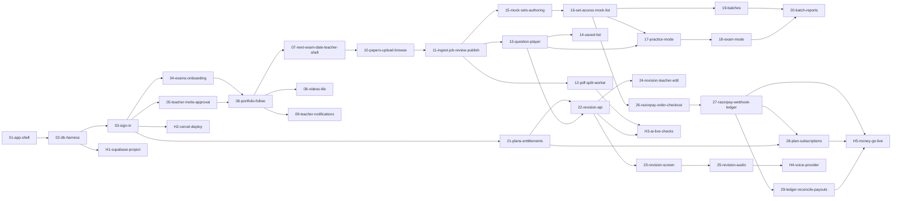

# PolityPedia v1 board (2026-11-04)

Built by /dev-work from `PRD-PolityPedia-v1.md` + `design.md` + the intake `decisions.md`. 29 afk tickets for Ralph, 5 human tickets for Boss.

| Ticket | Type | Blocked by |
|---|---|---|
| 01-app-shell | afk | none |
| 02-db-harness | afk | 01-app-shell |
| 03-sign-in | afk | 02-db-harness |
| 04-exams-onboarding | afk | 03-sign-in |
| 05-teacher-invite-approval | afk | 03-sign-in |
| 06-portfolio-follow | afk | 04-exams-onboarding, 05-teacher-invite-approval |
| 07-next-exam-date-teacher-shell | afk | 06-portfolio-follow |
| 08-videos-tile | afk | 06-portfolio-follow |
| 09-teacher-notifications | afk | 06-portfolio-follow |
| 10-papers-upload-browse | afk | 07-next-exam-date-teacher-shell |
| 11-ingest-job-review-publish | afk | 10-papers-upload-browse |
| 12-pdf-split-worker | afk | 11-ingest-job-review-publish |
| 13-question-player | afk | 11-ingest-job-review-publish |
| 14-saved-list | afk | 13-question-player |
| 15-mock-sets-authoring | afk | 11-ingest-job-review-publish |
| 16-set-access-mock-list | afk | 15-mock-sets-authoring |
| 17-practice-mode | afk | 16-set-access-mock-list, 13-question-player |
| 18-exam-mode | afk | 17-practice-mode |
| 19-batches | afk | 16-set-access-mock-list |
| 20-batch-reports | afk | 19-batches, 18-exam-mode |
| 21-plans-entitlements | afk | 03-sign-in |
| 22-revision-api | afk | 21-plans-entitlements, 13-question-player |
| 23-revision-screen | afk | 22-revision-api |
| 24-revision-teacher-edit | afk | 22-revision-api |
| 25-revision-audio | afk | 23-revision-screen |
| 26-razorpay-order-checkout | afk | 16-set-access-mock-list |
| 27-razorpay-webhook-ledger | afk | 26-razorpay-order-checkout |
| 28-plan-subscriptions | afk | 27-razorpay-webhook-ledger, 21-plans-entitlements |
| 29-ledger-reconcile-payouts | afk | 27-razorpay-webhook-ledger |
| H1-supabase-project | human | 02-db-harness |
| H2-vercel-deploy | human | 03-sign-in |
| H3-ai-live-checks | human | 12-pdf-split-worker, 22-revision-api |
| H4-voice-provider | human | 25-revision-audio |
| H5-money-go-live | human | 27-razorpay-webhook-ledger, 28-plan-subscriptions, 29-ledger-reconcile-payouts |

## v1.1 teacher tools (2026-11-06)

| Ticket | Type | Blocked by |
|---|---|---|
| 45-keep-money-and-scores | afk | none |
| 46-teacher-setup-checklist | afk | 45 |
| 47-videos-youtube-and-instagram | afk | 46 |
| 48-news-text-and-link-preview | afk | H6, 47 |
| 49-subjects-and-topics | afk | 45 |
| 50-mock-editor-power-tools | afk | 49 |
| 51-batch-invite-links | afk | H6, 50 |
| 52-batch-announcements | afk | 51 |
| 53-teacher-basic-analytics | afk | 49 |
| H6-teacher-v11-picks | human | none |

Design: `.planning/intake/2026-11-06-teacher-v1.1/design.md`. Page: https://claude.ai/artifact/EK4km7gvvmR5Cjx9FjjG8z
